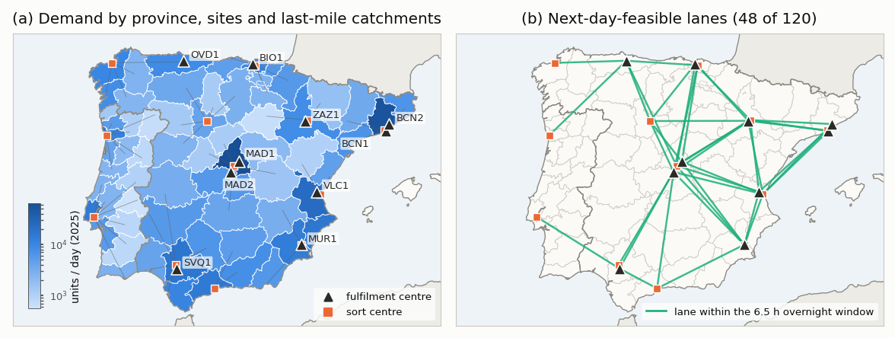
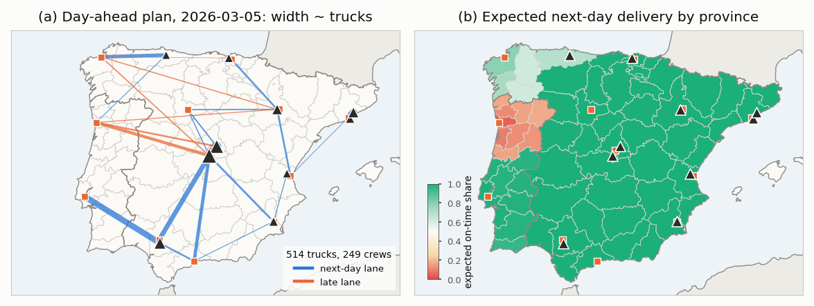
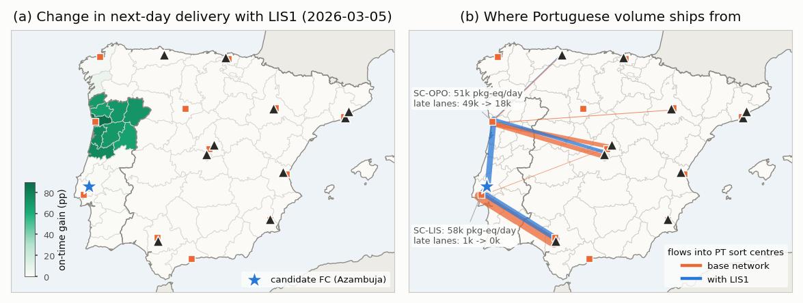

# Forecast-to-Fulfilment

**Probabilistic demand forecasting, two-stage stochastic capacity planning and online order assignment for an Iberian e-commerce fulfilment network.**

Every evening a fulfilment network commits trucks and labour for tomorrow before the orders exist; the next day every unit has to be assigned, irrevocably, to a fulfilment centre that has the item, the labour, space on a truck — and ideally a lane short enough to keep the next-day promise. This project builds the full chain of models behind those decisions and evaluates every layer by what it costs the next one:

```
 demand model ─▶ probabilistic forecasts ─▶ joint scenarios ─▶ day-ahead stochastic plan ─▶ online assignment
 (generative,      (LightGBM-Q + conformal,   (Gaussian copula)   (two-stage MIP, Benders)     (LP bid prices /
  known truth)      Chronos-Bolt baseline)                                                      fluid tracking)
```

📄 **Full report:** [`report/main.pdf`](report/main.pdf) (30 pages: formulation, proofs, algorithms, experiments).

<p align="center"></p>

## The problem

* **Network** — mainland Spain and Portugal: 65 demand zones (provinces/districts, real coordinates and populations), 10 fulfilment centres, 12 sort centres, 4 product categories, ≈450k units/day (>1M on Black Friday / Prime Day). Only 48 of 120 line-haul lanes fit the overnight window, so *where* a unit ships from decides whether the promise is kept.
* **Demand** — a generative model with trend, weekly/annual seasonality, Black Friday, Prime events, Christmas, *Reyes Magos*, *rebajas*, national/regional holidays, promotions, weather, and correlated national/regional/category shocks. Because the latent states are known, the **true conditional distribution** of tomorrow's demand can be sampled — every plan is scored against the truth, not against one noisy realisation.
* **Planning** — integer trucks per lane and crews per FC, decided the day before; recourse = order assignment LP with overtime, spot capacity and unshipped units.
* **Online** — units arrive over 96 intraday slots and are assigned irrevocably against the committed capacity.

## Headline results

| Layer | Result |
|---|---|
| Forecasting (365-day test year, 260 series) | Global LightGBM quantile model: **wMAPE 11.9%** vs 24.3% seasonal naive vs 15.4% Chronos-Bolt (zero-shot foundation model) vs 9.6% oracle. Rolling conformal calibration: 80% interval coverage **71.6% → 79.3%**. |
| Joint scenarios | Independent sampling makes the national total look 3× too certain (90% PI covers 30%); a Gaussian copula on PIT residuals restores **82%**. |
| Optimisation | Benders with LP phase + in-out stabilisation + partial decomposition (Jensen block) solves the 100-scenario SAA (254k columns) to 0.05% in seconds; the ablation shows **≥90×** over classic Benders and **12×** over the extensive form (N=100); N=1000 (2.5M columns) solves in 41 s. |
| Value of forecasts (31 days, scored on true distribution) | Remaining forecast error costs **€16k/day**; a per-series P90 buffer wastes **€96k/day** (≈ €35M/yr); naive forecasts lose **€1.2M/day** on event days. |
| Cost vs speed vs CO₂ | Next-day share 83.5% → 91.0% costs only €8k/day — then the frontier turns vertical (network limit). Speed is bought by routing, not capacity. Line-haul CO₂ abatement costs €270–1160/t. |
| Online assignment (124 simulated days) | Greedy: 7.1% above clairvoyant LP. Static bid prices close 22% of the gap, hourly re-solved bid prices 67%, **fluid LP tracking 79%** (≈ €110k/day). |
| Investment what-if | A fulfilment centre near Lisbon: Portugal next-day **54% → 93%**, CO₂ −10%, **€9.3M/yr** operating savings (€18.3M/yr incl. value of speed) = break-even annual site cost. |

<p align="center"></p>
<p align="center"></p>

## Repository layout

```
fulfillopt/                 # the library (~2.6k lines)
  geo.py, network.py        # Iberian geography, lanes, transit times, cost model
  demand.py                 # generative demand model + oracle conditional sampler
  forecast/                 # features, LightGBM-Q, conformal calibration, metrics, copula scenarios
  planning/
    model.py                # two-stage SP in sparse matrix form, extensive form, Jensen linking
    benders.py              # multi-cut Benders: LP phase, in-out, partial decomposition, parallel workers
    solve.py                # planning API, out-of-sample evaluation, wait-and-see, epsilon-constraint
  online/simulator.py       # intraday simulator, greedy / bid-price / LP-tracking policies, hindsight LP
  pipeline.py               # forecast -> scenarios -> plan glue
  geo_plot.py, viz.py       # basemap (Natural Earth) and figure style
experiments/                # e01..e09: one script per experiment, figures.py, tables.py
tests/                      # cut validity, Benders = extensive form, PIT round-trip, copula, online invariants
report/                     # LaTeX report; all tables are generated from results/*.csv
```

## Reproduce

```bash
make install        # venv + package (HiGHS 1.15, LightGBM, PyTorch for Chronos)
make test           # unit tests
make all            # forecasting -> planning -> computation -> pareto -> online -> network -> report
```

Individual experiments: `python -m experiments.e05_value_of_forecasts`, etc. Everything is seeded. Solvers: [HiGHS](https://highs.dev) (LP/MIP, open source), LightGBM, Chronos-Bolt (GPU optional: the zero-shot backtest takes under 3 min on an RTX 5070 Ti).

## Notes

All data are synthetic and all sites, capacities and costs are stylised — nothing here is proprietary data of any company. Map boundaries: [Natural Earth](https://www.naturalearthdata.com) (public domain).

## License

Code: [MIT](LICENSE). Report and figures: © 2026 Panagiotis Kiousis.
